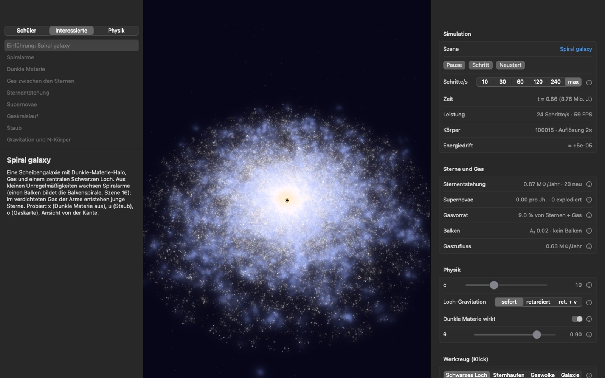
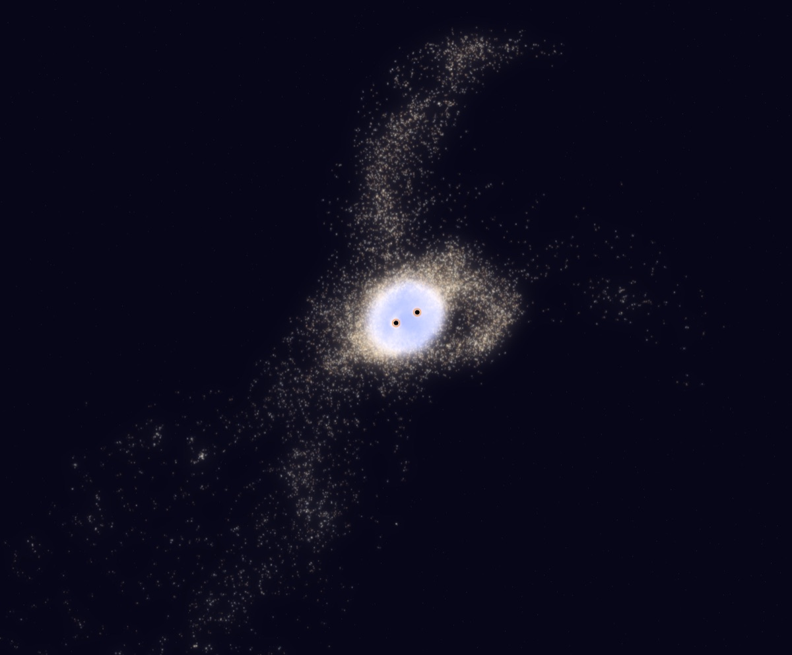
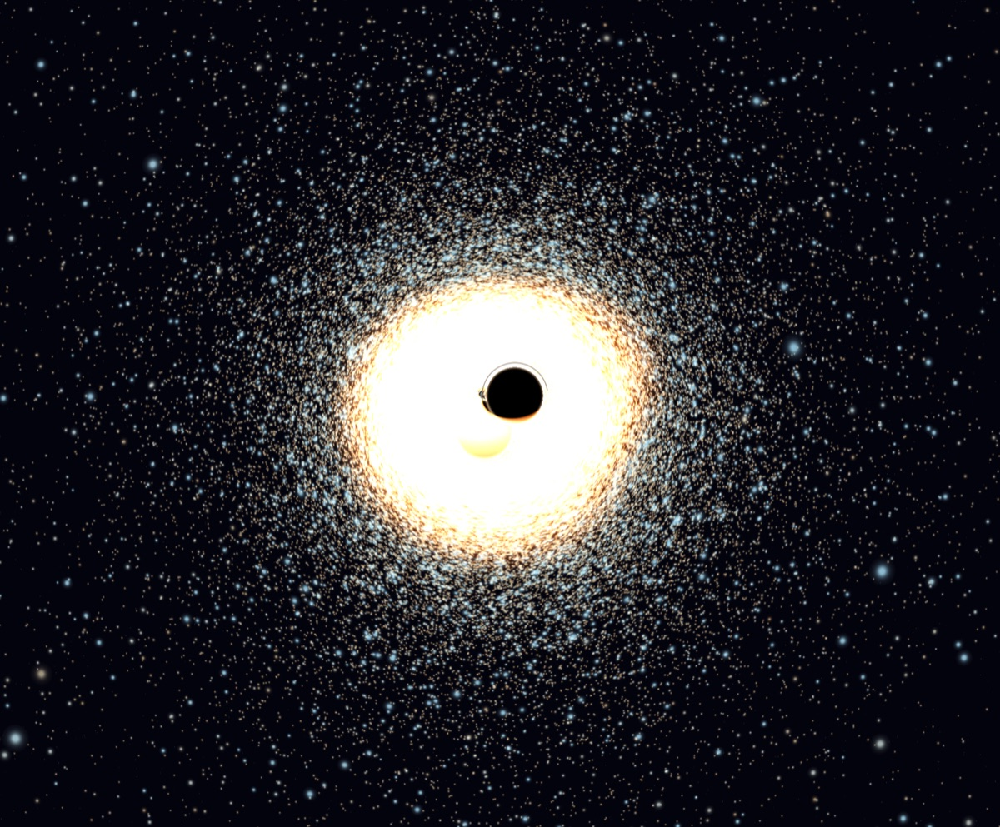
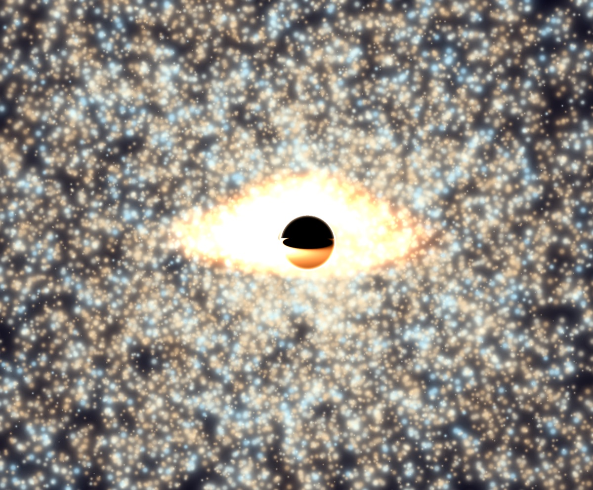
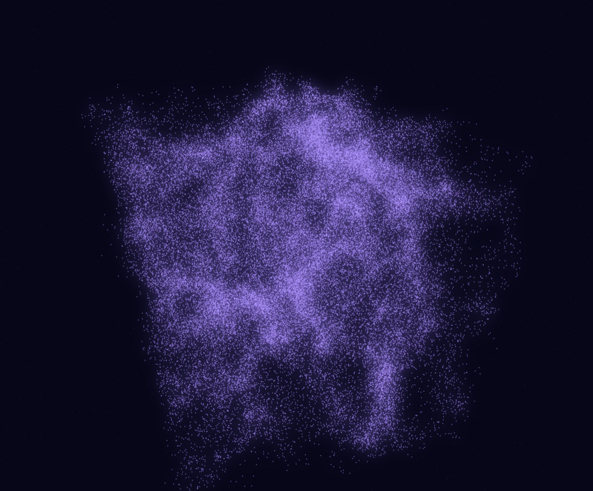
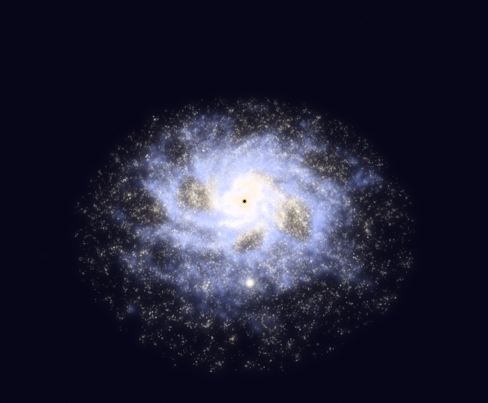
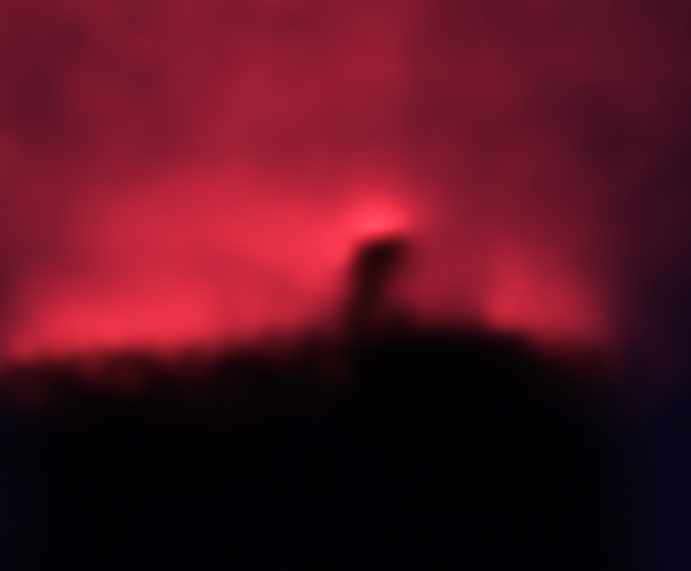

# Gravitas – Galaxy Sandbox

**Wie entstehen Spiralarme, Gezeitenschweife und neue Sterne, wenn man eine Galaxie einfach nach den Gesetzen
der Physik rechnet?** Gravitas simuliert das live auf dem Mac: 10⁴ bis 10⁵ Teilchen aus Sternen, Gas, Dunkler
Materie und Schwarzen Löchern, mit Sternentstehung, Supernovae und Szenen nach echten Vorbildern. Die Strukturen
sind nicht animiert, sie ergeben sich aus den Kräften. Man kann zuschauen, eingreifen und nachlesen, was das Modell
abbildet und wo es vereinfacht.

*A realistic, interactive N-body simulation for macOS: galaxies with gas, star formation, supernovae, dark matter
and black holes, scenes modelled on real objects, in German and English.*

[**⬇ Gravitas für macOS laden**](https://github.com/gsteinacker/gravitas/releases/latest/download/Gravitas.dmg)
(Apple Silicon und Intel, macOS 14+) · [alle Versionen](https://github.com/gsteinacker/gravitas/releases) ·
[Installation](#installieren-macos-14-oder-neuer-apple-silicon-und-intel)



| | |
|---|---|
|  |  |
| **Kollision** (Szene 2): Nach dem ersten Durchgang reißen Gezeitenkräfte lange Schweife aus beiden Scheiben, die zentralen Löcher umkreisen einander. | **Loch-Doppel im Sternhaufen** (Szene 4, c = 3): Die Linse verbiegt das Licht der Sterne dahinter, der Horizont wächst mit kleinerem c. |
|  |  |
| **Akkretionsscheibe** (Szene 11): Eine Gaswolke streift ein Loch von 10 000 Sonnenmassen, die Gezeiten zerreißen sie. Die Scheibe leuchtet so hell, wie das Loch gerade Masse schluckt. | **Kosmisches Netz** (Szene 12): Ein Würfel von 480 Millionen Lichtjahren Dunkler Materie mit Filamenten und Knoten, wie das Standardmodell (ΛCDM, Planck 2018) sie heute vorhersagt. |
|  |  |
| **Spiralgalaxie** (Szene 1): Arme entstehen aus kleinen Störungen, im verdichteten Gas bilden sich junge, blaue Sterne. | **Pferdekopfnebel** (Szene 9): UV-Licht von Sigma Orionis bringt den Wasserstoff zum Leuchten, die dichte Staubsäule wirft Schatten. |

## Was drinsteckt

- **Echte Physik, ehrlich vereinfacht:** Barnes-Hut-Baum (wahlweise auf der GPU), Gas als SPH mit Kühlung,
  Sternentstehung und Supernovae, rotierende Löcher mit Frame Dragging, Dunkle Materie, ein mitbewegter Modus mit
  kosmischer Expansion. Was vereinfacht ist und warum, steht in [docs/physics.md](docs/physics.md) und in
  [ADRs](docs/adr); der Inspektor zeigt die Energiedrift.
- **16 Szenen nach echten Vorbildern:** Lokale Gruppe in echten Abständen, Antennen, Whirlpool (M51), die S-Sterne
  um Sgr A\*, die Satelliten der Milchstraße, eine Balkenspirale. Jede Szene ist eine JSON-Datei mit Quellen und
  Annahmen ([Format](docs/scenes.md)), eigene Szenen lassen sich laden.
- **Lichtgeschwindigkeit als Regler:** `c` ist ein Parameter. Wird es kleiner, wachsen die Horizonte
  (r_s = 2GM/c²), Sterne stürzen ab der innersten stabilen Bahn (3 r_s) hinein, und die Gravitation der Löcher
  breitet sich auf Wunsch mit c aus (retardiert). Gravitationslinse und Doppler-Farben machen das sichtbar.
- **Selber eingreifen:** Schwarze Löcher, Sternhaufen, Gaswolken oder ganze Galaxien per Klick setzen und mit
  Kreisbahn-, Flucht- oder freier Geschwindigkeit losschicken. Stände speichern und später weiterrechnen.
- **Lernmodus in drei Stufen:** zu jeder Szene und jedem Konzept eine Erklärung für Schüler, Interessierte und
  Physiker, in der Physik-Stufe mit den Grenzen des Modells. Jeder Regler hat ein (i) mit Erklärung.
- **Passt sich dem Rechner an:** Gravitas misst beim ersten Start die Leistung und wählt Sternzahl und Auflösung
  für flüssige 30 Schritte/s.

## Installieren (macOS 14 oder neuer, Apple Silicon und Intel)

1. [`Gravitas.dmg`](https://github.com/gsteinacker/gravitas/releases/latest/download/Gravitas.dmg) laden (neueste
   Version, ältere unter [Releases](https://github.com/gsteinacker/gravitas/releases)), öffnen und **Gravitas** auf
   **Applications** (Programme) ziehen.
2. Beim ersten Start meldet macOS, dass die App nicht geprüft werden kann. Sie ist (noch) nicht bei Apple
   notarisiert. Einmalig freigeben:
   - **macOS 15 und neuer:** Gravitas starten und die Meldung schließen. Dann unter *Systemeinstellungen →
     Datenschutz & Sicherheit* bei „Gravitas wurde blockiert“ auf **Trotzdem öffnen** klicken.
   - **macOS 14:** Im Finder bei gedrückter ctrl-Taste auf Gravitas klicken, dann **Öffnen** wählen.
3. Beim ersten Start misst Gravitas etwa 0,1 s lang die Leistung des Rechners. Daraus wählt es die Sternzahl für
   flüssige 30 Schritte/s. Danach passt es Auflösung und Genauigkeit laufend an. In den *Einstellungen* (⌘,)
   lassen sich das Profil, eine feste Sternzahl oder die Grafikkarte wählen, dort gibt es auch „Leistung neu
   messen“.

Speicherstände (`.gravitas`, ältere `.galaxy`) öffnen sich per Doppelklick. Einstellungen und Stände liegen unter
`~/Library/Application Support/Gravitas`. Ein Ordner `Galaxy` aus Versionen vor der Umbenennung wird beim ersten Start
übernommen. Weil sich die Bundle-ID geändert hat, fragt macOS beim ersten Start von Gravitas erneut nach der Freigabe;
eine alte `Galaxy.app` kann danach gelöscht werden.

**Bauen** (braucht Xcode mit Metal-Toolchain):
- `make app` erzeugt `bin/Gravitas.app` (Universal, ad-hoc signiert).
- `make dmg` erzeugt das Disk-Image.
- `make clean` löscht alle Build-Ergebnisse (`bin/`, Swift-Build).
- **Neue Version veröffentlichen:** `git tag v0.2.0 && git push origin v0.2.0`. Der Workflow
  [`release`](.github/workflows/release.yml) baut auf einem macOS-Runner, testet und hängt `Gravitas-0.2.0.dmg` und
  `Gravitas.dmg` an das GitHub-Release; der Download-Link oben zeigt dann auf die neue Version.
- Mit einem Apple-Developer-Zertifikat signiert und notarisiert
  `make notarize SIGN_ID="Developer ID Application: …" NOTARY_PROFILE=…`. Das Profil wird vorher einmal mit
  `xcrun notarytool store-credentials` angelegt.

## Entwickeln

```sh
make run                                        # Start (Sternzahl nach Leistungsprofil, Spiralgalaxie)
make run ARGS="-n 50000 -c 2.5"                 # kleines c: das zentrale Loch frisst die Galaxie
make run ARGS="-preset 5"                       # Lokale Gruppe in echten Abständen (x/v: Dunkle Materie)
make run ARGS="-scene $PWD/meine.json"          # eigene Szene (docs/scenes.md); -load …/x.gravitas lädt einen Stand
make run ARGS="-preset 4 -c 3"                  # Doppel-Loch mit Linseneffekt
make run ARGS="-preset 2 -fx glow,doppler,trails"   # Kollision mit Bahnspuren
make run ARGS="-preset 14"                      # Galaxienentstehung aus Halo-Gas (Szenen ab 10: Menü / ⇧⌘N)
make shot PRESET=9                              # Screenshot bin/shot.png mit Messzeile
make plan                                       # Fortschritt im Backlog
make check                                      # fmt, vet, Tests, Backlog-Validierung (Go-Kern)
```

**Parameter** (für `make run ARGS="…"` oder direkt `./bin/swift/GalaxySwift …`, Quelle:
`internal/engine/options.go`):

| Parameter | Bedeutung |
|-----------|-----------|
| `-preset N` | Startszene, ab 1 (Standard 1) |
| `-scene datei.json` / `-load stand.gravitas` | Eigene Szene ([Format](docs/scenes.md)) / gespeicherten Stand laden |
| `-n N` | Sternzahl (0 = nach Leistungsprofil, Screenshots: 50 000) |
| `-c X` | Lichtgeschwindigkeit (0 = Vorgabe der Szene, −1 = Newton ohne c) |
| `-gravity M` | Gravitation der Löcher: `instant`, `retarded`, `retarded+v` |
| `-theta X` | Öffnungswinkel des Barnes-Hut-Baums, kleiner = genauer (Standard 0,9) |
| `-gpu=false` | Baumdurchlauf auf der CPU statt auf der GPU |
| `-fx a,b,…` | Effekte: `glow`, `lens`, `doppler`, `trails`, `dark`, `gas`, `dust` |
| `-lang de\|en` | Sprache (Standard: System) |
| `-explain stufe[:thema]` | Lernmodus öffnen: `school`, `lay`, `physics`, optional mit Thema |
| `-hud` / `-help` / `-scenes` / `-intro` | Statuszeile / Tastenübersicht / Szenenübersicht / Vorspann zeigen |
| `-info id` | Erklärung eines Reglers öffnen, z. B. `c`, `theta`, `dust` |
| `-tool T` / `-mass X` | Werkzeug `hole`, `cluster`, `cloud`, `galaxy` / Masse platzierter Objekte |
| `-launch x,y[,p[,1]]` | Start planen bei x,y (Anteile der Bildgröße), p: 0 Ruhe, 1 Kreisbahn, 2 Flucht, 3 Zentrum, 4 Doppel; `,1` startet sofort |
| `-zoom X` / `-target x,y,z` | Vergrößerung / Kamera auf Weltkoordinaten |
| `-shot bild.png` / `-shot-after S` | Screenshot nach S Sekunden (Standard 4) speichern und beenden; gibt eine Messzeile aus |
| `-scale X` / `-adapt` | Pixel pro Punkt, z. B. 2 für Retina (0 = adaptiv) / Screenshot passt Qualität und Sternzahl an wie die App |

Alle Aktionen stehen auch in der Menüleiste und im Inspektor (⌥⌘I). `?` oder `F1` zeigt die Übersicht in der App.

**Szenen** ([Format und Quellen](docs/scenes.md)), im Menü *Ablage → Neu aus Szene* und in der Szenenübersicht
(⇧⌘N) nach Gruppen. Die ersten neun liegen auf den Zifferntasten, alle sind per `-preset N` startbar.

| Gruppe | Szenen |
|--------|--------|
| Galaxien | `1` Spiralgalaxie, `2` Galaxienkollision, `5` Lokale Gruppe, `6` Antennen, `7` Whirlpool (M51), 14 Galaxienentstehung, 15 Satelliten der Milchstraße (LMC, SMC, Sagittarius), 16 Balkenspirale |
| Sterne und Schwarze Löcher | `3` Sternhaufen, `4` Loch-Doppel im Haufen, `8` S-Sterne um Sgr A\* |
| Gas und Sternentstehung | `9` Pferdekopfnebel, 10 Direkter Kollaps, 11 Akkretionsscheibe |
| Kosmos | 12 Kosmisches Netz, 13 Strukturbildung (mitbewegt, mit Expansion) |

| Eingabe | Aktion |
|---------|--------|
| `1`–`9` / ⇧⌘N | Szene laden / Szenenübersicht |
| `b` `k` `w` `a` `Tab` | Werkzeug: Schwarzes Loch / Sternhaufen / Gaswolke / Galaxie / wechseln (`m` `n` ändern die Masse) |
| Klick | Startrampe: Objekt auf der Scheibenebene, Griffe ziehen (gelb mit/gegen die Drehung, cyan außen/innen, magenta oben/unten), `↩` startet, `⎋` verwirft; ⌘ beim Ziehen ohne Einrasten |
| Doppelklick / Objekt ziehen / ⌥-Ziehen | Sofort platzieren / Schleuder / Richtung und Tempo ziehen und starten |
| Ziehen / ⇧- oder Rechts-Ziehen / Rad, Pinch | Rotieren / Verschieben / Zoom |
| `<` `>` | Lichtgeschwindigkeit verringern / erhöhen (kleines c → große Horizonte) |
| `Leertaste` `.` `+` `-` `r` | Pause, Einzelschritt, Tempo, Neustart |
| `e` | **Lernmodus**: Einführung zur Szene und Erklärungen (←/→ Thema, ↑/↓ Zielgruppe: Schüler, Interessierte, Physik) |
| `x` `v` | Dunkle Materie: Gravitation an/aus, sichtbar machen |
| `F5` `F9` | Spielstand speichern / neuesten laden (`~/Library/Application Support/Gravitas/saves`) |
| `o` `u` | Gaskarte (Falschfarben) / Staubabsorption |
| `p` | Gravitation der Löcher: instantan / retardiert / retardiert + v (Ausbreitung mit c) |
| `g` `t` `l` `d` | Effekte: Glow, Spuren, Gravitationslinse, Doppler-Farben |
| `h` `?`/`F1` `f` `c` | Statusanzeige, Tastenübersicht, Vollbild, Ansicht zentrieren |

Doku: [Stack-Analyse](docs/analysis/01-tech-stack.md) · [Architektur](docs/architecture.md) ·
[Physik](docs/physics.md) · [Szenen](docs/scenes.md) · [ADRs](docs/adr) ·
[Performance-Log](docs/perf-log.md) · [Roadmap](planning/ROADMAP.md)
